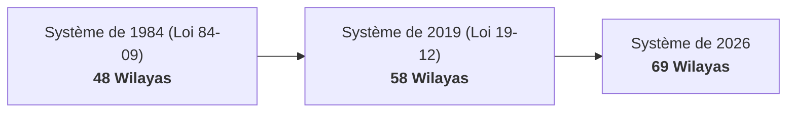

<a id="top"></a>

<p align="right">
  <a href="./README.md">English</a> &nbsp;|&nbsp;
  <a href="./README.ar.md">العربية</a> &nbsp;|&nbsp;
  <strong>Français</strong>
</p>

<div align="center">

  <a href="https://github.com/test-bit-sys/algeria-geo">
    
  </a>

  <br/><br/>

  # 🇩🇿 algeria-geo

  **La bibliothèque géospatiale et administrative de référence pour l'Algérie, sans dépendances d'exécution.**<br/>
  *69 Wilayas, 538 Daïras et 1 541 Communes avec gestion des découpages historiques (48, 58, 69) et recherche multilingue.*

  <br/>

  [](https://github.com/test-bit-sys/algeria-geo/actions/workflows/ci.yml)
  [](https://pypi.org/project/algeria-geo/)
  [](https://www.npmjs.com/package/algeria-geo/)
  [](LICENSE)
  [](https://pypi.org/project/algeria-geo/)
  [](https://www.npmjs.com/package/algeria-geo/)
  [](#fonctionnalités)

  <br/>

  [](https://t.me/+WeiJNOn1gJkzNzFk)
  [](https://t.me/safouanedz1)
  [](https://discord.com)

</div>

---

## Sommaire

- [Fonctionnalités](#fonctionnalités)
- [Couverture administrative](#couverture-administrative)
- [Installation](#installation)
- [Démarrage rapide](#démarrage-rapide)
  - [TypeScript / JavaScript](#typescript--javascript)
  - [Python](#python)
- [Référence de l'API](#référence-de-lapi)
- [Découpages historiques (48, 58, 69)](#découpages-historiques-48-58-69)
- [Distributions prêtes à l'emploi (JSON, CSV, SQL)](#distributions-prêtes-à-lemploi)
- [Source des données et citations](#source-des-données-et-citations)
- [Compilation depuis les sources](#compilation-depuis-les-sources)
- [Contribution](#contribution)
- [Licence](#licence)

---

## Fonctionnalités

- 🇩🇿 **Couverture officielle exhaustive** : Les **69 wilayas** (y compris la réorganisation administrative de 2026 : Wilayas 59 à 69), **538 daïras** et **1 541 communes**.
- ⏳ **Gestion des découpages historiques** : Interrogez les limites territoriales selon les découpages à **48** (1984), **58** (2019) et **69** wilayas (actuel).
- 🔍 **Recherche floue et phonétique** : Recherche tolérante aux accents, diacritiques arabes (tashkeel), variantes de lettres et translittérations (`Warqla` = `Ouargla` = `ورقلة`).
- ⚡ **Zéro dépendance d'exécution** : Implémentation basée sur les bibliothèques standard, ultra-légère avec recherches en mémoire instantanées en $O(1)$.
- 📦 **Parité absolue des écosystèmes** : Mêmes signatures, modèles et performances en **TypeScript** (ESM + CommonJS) et **Python** (strictement typé).
- 🗄️ **Exports multi-formats** : Fichiers SQL prêts à l'emploi (PostgreSQL, SQLite, MySQL / MariaDB), JSON minifiés, arborescence hiérarchique et CSV UTF-8.

---

## Couverture administrative

| Niveau | Nombre | Identifiants | Noms disponibles |
|---|:---:|---|---|
| **Wilayas** | **69** | `01` à `69` (Code ONS à 2 chiffres) | Arabe, Français, Romanisé ASCII |
| **Daïras** | **538** | `0101` à `6912` (Code à 4 chiffres) | Arabe, Français, Romanisé ASCII |
| **Communes** | **1 541** | `0101` à `6912` (Code ONS à 4 chiffres) | Arabe, Français, Romanisé ASCII |

> [!NOTE]
> Les noms sont fournis en arabe (`name_ar`) et en français (`name_fr`). Le champ `name_en` correspond à une translittération ASCII dérivée de la graphie officielle. Les codes postaux officiels à 5 chiffres (`post_code`) et les coordonnées GPS (`latitude`, `longitude`) sont vérifiés et disponibles pour les 1 541 communes. Les indicatifs téléphoniques régionaux (`phone_code`) sont renseignés pour l'ensemble des 69 wilayas.

---

## Installation

### Node.js / TypeScript

```bash
# npm
npm install algeria-geo

# pnpm
pnpm add algeria-geo

# yarn
yarn add algeria-geo

# bun
bun add algeria-geo
```

### Python

```bash
# pip
pip install algeria-geo

# uv
uv add algeria-geo

# poetry
poetry add algeria-geo
```

---

## Démarrage rapide

### TypeScript / JavaScript

Compatible Node.js, Bun, Deno, Next.js, Nuxt, Vite et navigateurs :

```ts
import {
  getWilaya,
  getDaira,
  getCommune,
  getCommunes,
  getWilayaByPhoneCode,
  getWilayaByCommune,
  search,
  toDropdownOptions,
} from "algeria-geo";

// 1. Recherche directe par code ou par nom multilingue
const alger = getWilaya(16); // accepte 16, "16", "Alger" ou "الجزائر"
console.log(alger?.name_fr); // "Alger"
console.log(alger?.communes_count); // 57

// 2. Recherche de daïra et de commune
const daira = getDaira("0301");
console.log(daira?.name_ar); // "الأغواط"

const commune = getCommune("0319");
console.log(commune?.name_fr); // "Aflou"
console.log(commune?.wilaya_code); // "59" (Nouvelle wilaya dans la réforme 2026)

// 3. Résolution inverse : À quelle wilaya appartient une commune selon l'époque ?
console.log(getWilayaByCommune("0319", 69)?.name_fr); // "Aflou" (Découpage 69)
console.log(getWilayaByCommune("0319", 58)?.name_fr); // "Laghouat" (Découpage 58)

// 4. Recherche par indicatif téléphonique
console.log(getWilayaByPhoneCode("021")?.name_fr); // "Alger"

// 5. Recherche floue et phonétique
const results = search("Warqla", { limit: 5 });
console.log(results.wilayas[0]?.item.name_fr); // "Ouargla"
console.log(results.wilayas[0]?.score); // 0.85

// 6. Options pour les menus déroulants HTML / React / Vue
const options = toDropdownOptions("fr");
// [{ value: "01", label: "Adrar" }, { value: "02", label: "Chlef" }, ...]
```

### Python

```python
import algeria_geo as geo

# 1. Recherche directe par code ou par nom
alger = geo.get_wilaya(16)  # accepte int ou str: "16", "Alger", "الجزائر"
print(alger.name_fr)         # "Alger"
print(alger.communes_count)  # 57

# 2. Recherche de daïra et de commune
daira = geo.get_daira("0301")
print(daira.name_fr)  # "Laghouat"

commune = geo.get_commune("0319")
print(commune.name_fr)       # "Aflou"
print(commune.wilaya_code)   # "59" (Aflou dans le découpage 69)

# 3. Résolution inverse de wilaya selon l'époque historique
print(geo.get_wilaya_by_commune("0319", era=69).name_fr)  # "Aflou"
print(geo.get_wilaya_by_commune("0319", era=58).name_fr)  # "Laghouat"

# 4. Recherche par indicatif téléphonique
print(geo.get_wilaya_by_phone_code("021").name_fr)  # "Alger"

# 5. Recherche floue intelligente
res = geo.search("Ouargla")
print(res.wilayas[0].item.name_fr)  # "Ouargla"
print(res.best.score)               # 1.0

# 6. Sérialisation JSON pour FastAPI / Django / Flask
import json
print(json.dumps(commune.to_dict(), ensure_ascii=False))

# 7. Préparation des options de formulaire web
dropdown = geo.to_dropdown_options(lang="fr")
# [{"value": "01", "label": "Adrar"}, {"value": "02", "label": "Chlef"}, ...]
```

---

## Référence de l'API

### Fonctions unifiées

| API Python | API TypeScript | Description |
|---|---|---|
| `get_wilaya(id, era=69)` | `getWilaya(id, era = 69)` | Trouve une wilaya par code (`16`, `"16"`) ou nom (Ar/Fr/En) |
| `get_wilayas(era=69)` | `getWilayas(era = 69)` | Liste les wilayas valides pour une époque administrative |
| `get_daira(code)` | `getDaira(code)` | Trouve une daïra par son code à 4 chiffres |
| `get_dairas(wilaya_code, era=69)` | `getDairas(wilayaCode, era = 69)` | Liste les daïras rattachées à une wilaya |
| `get_all_dairas(era=69)` | `getAllDairas(era = 69)` | Liste l'ensemble des daïras d'Algérie pour une époque |
| `get_commune(code)` | `getCommune(code)` | Trouve une commune par son code ONS à 4 chiffres |
| `get_communes(wilaya_code, era=69)`| `getCommunes(wilayaCode, era = 69)`| Liste les communes rattachées à une wilaya |
| `get_all_communes(era=69)` | `getAllCommunes(era = 69)` | Liste l'ensemble des communes d'Algérie pour une époque |
| `get_communes_by_daira(daira_code)`| `getCommunesByDaira(dairaCode)` | Liste les communes rattachées à une daïra |
| `get_wilaya_by_commune(code, era=69)`| `getWilayaByCommune(code, era = 69)`| Trouve la wilaya parente d'une commune |
| `get_wilaya_by_phone_code(phone)` | `getWilayaByPhoneCode(phone)` | Trouve la wilaya par son indicatif téléphonique (`"021"`) |
| `search(query, lang, limit)` | `search(query, langOrOptions, limit)` | Recherche floue multilingue sur toutes les divisions |
| `get_postal_code(name, wilaya)` | `getPostalCode(name, wilaya)` | Recherche le code postal (lorsque renseigné) |
| `to_dropdown_options(lang, era)` | `toDropdownOptions(lang, era)` | Prépare les options `{ value, label }` pour selects HTML |

---

## Découpages historiques (48, 58, 69)

L'organisation territoriale de l'Algérie a connu trois réorganisations législatives majeures :



`algeria-geo` préserve l'affiliation historique intégrale. En renseignant `era=48` ou `era=58`, vos requêtes reflètent les découpages passés :

```python
# Dans le système à 58 wilayas, Aflou appartenait à Laghouat (03)
communes_58 = geo.get_communes("03", era=58)

# Dans le système actuel à 69 wilayas, Aflou est sa propre wilaya (59)
communes_69 = geo.get_communes("59", era=69)
```

---

## Distributions prêtes à l'emploi

Les distributions générées se trouvent dans le dossier [`dist/`](dist/) :

| Fichier | Format | Description |
|---|:---:|---|
| [`dist/wilayas.min.json`](dist/wilayas.min.json) | JSON | Tableau minifié des 69 wilayas avec décompte des daïras/communes |
| [`dist/dairas.min.json`](dist/dairas.min.json) | JSON | Tableau minifié des 538 daïras avec affiliation historique |
| [`dist/communes.min.json`](dist/communes.min.json) | JSON | Tableau minifié des 1 541 communes avec affiliation historique |
| [`dist/tree.min.json`](dist/tree.min.json) | JSON | Arbre hiérarchique imbriqué : Wilayas ➔ Daïras ➔ Communes |
| [`dist/csv/*.csv`](dist/csv/) | CSV | Exports CSV en UTF-8 avec BOM (compatible Excel) |
| [`dist/algeria_geo.sql`](dist/algeria_geo.sql) | SQL | Script DDL et INSERT prêt pour PostgreSQL et SQLite |
| [`dist/algeria_geo.mysql.sql`](dist/algeria_geo.mysql.sql) | SQL | Script optimisé pour MySQL 8 et MariaDB (`utf8mb4`) |

---

## Sources de données et attributions

Les limites administratives, la nomenclature, les codes postaux et les coordonnées d'**algeria-geo** sont compilés et vérifiés à partir des textes officiels et de jeux de données géographiques ouverts :

1. **Découpage administratif et nomenclature :**
   - Transcrits fidèlement depuis les textes légaux publiés au *Journal officiel de la République algérienne démocratique et populaire*, avec pour socle initial [djazairdev/wilayas](https://github.com/djazairdev/wilayas/tree/0b3b6ab2ac1b1569469285d8fe5e7df18666fcdf).
   - Les 57 communes d'Alger (16) relèvent du statut particulier des circonscriptions administratives et conservent `daira_code: null` dans la nomenclature statistique officielle.

2. **Codes postaux et coordonnées vérifiées (GeoAlgeria) :**
   - Les codes postaux officiels à 5 chiffres et les coordonnées des centres communaux sont issus du projet [GeoAlgeria](https://github.com/yasserstudio/geoalgeria) de Yasser Studio, sous **licence MIT**. Copyright (c) 2026 Yasser Studio.

3. **Données OpenStreetMap (ODbL 1.0) :**
   - 323 des 1 541 coordonnées communales sont dérivées des relations OpenStreetMap via GeoAlgeria et sont mises à disposition sous licence [Open Database License (ODbL) 1.0](https://opendatacommons.org/licenses/odbl/1-0/) : **© les contributeurs d'OpenStreetMap**.

Consultez [NOTICE](NOTICE) et [LICENSE](LICENSE) pour plus de détails.

---

## Compilation depuis les sources

```bash
# 1. Valider l'intégrité des données canoniques
python scripts/build.py --check

# 2. Générer les distributions (JSON, CSV, SQL, packages)
python scripts/build.py

# 3. Réimporter les dernières sources officielles
python scripts/import_source.py
python scripts/build.py
```

---

## Contribution

Les contributions sont les bienvenues ! Consultez [CONTRIBUTING.md](CONTRIBUTING.md) pour les règles de citation des décrets officiels et les consignes de tests.

---

## Licence & Mentions légales

- **Logiciel & Bibliothèques :** Publiés sous licence [MIT](LICENSE). Copyright (c) 2026 test-bit-sys.
- **Compilation des données et codes postaux :** Dérivés du projet [GeoAlgeria](https://github.com/yasserstudio/geoalgeria) sous licence [MIT](https://opensource.org/licenses/MIT). Copyright (c) 2025-2026 Yasser's studio (https://yasser.studio).
- **Coordonnées dérivées d'OpenStreetMap :** 323 coordonnées de centres communaux proviennent d'OpenStreetMap via GeoAlgeria et sont régies par la licence [Open Database License (ODbL) 1.0](https://opendatacommons.org/licenses/odbl/1-0/) (**© contributeurs OpenStreetMap**), et ne sont pas sous CC0.
- **Nomenclature administrative officielle :** Transcrite directement à partir du Journal officiel de la République algérienne.

Consultez le fichier [NOTICE](NOTICE) pour tous les détails d'attribution et de licences.

<p align="right"><a href="#top">Haut de page ↑</a></p>
