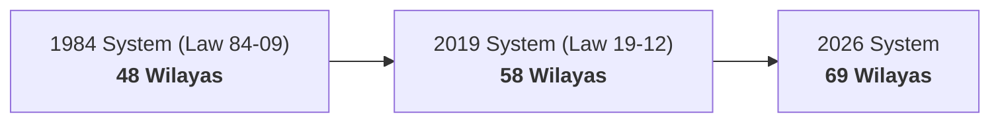

<a id="top"></a>

<p align="right">
  <strong><a href="#english">English</a></strong> &nbsp;|&nbsp; <strong><a href="#arabic">العربية</a></strong>
</p>

<div align="center">

  <a href="https://github.com/djazairdev/algeria-geo">
    
  </a>

  <br/><br/>

  # 🇩🇿 algeria-geo

  **The definitive, zero-runtime-dependency geospatial & administrative dataset for Algeria.**<br/>
  *69 Wilayas, 538 Dairas, and 1,541 Communes with historical boundary views (48, 58, 69) and cross-script search.*

  <br/>

  [](https://github.com/djazairdev/algeria-geo/actions/workflows/ci.yml)
  [](https://pypi.org/project/algeria-geo/)
  [](https://www.npmjs.com/package/algeria-geo/)
  [](LICENSE)
  [](https://pypi.org/project/algeria-geo/)
  [](https://www.npmjs.com/package/algeria-geo/)
  [](#features)

</div>

---

## Table of Contents

- [Features](#features)
- [Administrative Coverage](#administrative-coverage)
- [Installation](#installation)
- [Quick Start](#quick-start)
  - [TypeScript / JavaScript](#typescript--javascript)
  - [Python](#python)
- [API Reference](#api-reference)
- [Historical Eras (48, 58, 69)](#historical-eras-48-58-69)
- [Data Distributions (JSON, CSV, SQL)](#data-distributions)
- [Data Source & Provenance](#data-source--provenance)
- [Building from Source](#building-from-source)
- [النسخة العربية (Arabic Version)](#arabic)
- [License](#license)

---

<a id="english"></a>

## Features

- 🇩🇿 **Complete Official Coverage**: All **69 wilayas** (including the 2026 administrative reform: Wilayas 59–69), **538 dairas**, and **1,541 communes**.
- ⏳ **Historical Boundary Eras**: Query administrative boundaries across **48** (1984), **58** (2019), and **69** (2026) wilaya systems.
- 🔍 **Cross-Script Fuzzy Search**: Intelligent search folding Arabic diacritics/tashkeel, French accents, letter variants, and phonetic transliterations (`Warqla` = `Ouargla` = `ورقلة`).
- ⚡ **Zero Runtime Dependencies**: Pure standard library implementation with instant in-memory $O(1)$ dictionary lookups.
- 📦 **Dual Ecosystem Parity**: Identical feature set, function names, and performance in both **TypeScript** (ESM + CommonJS) and **Python** (Typed).
- 🗄️ **Multi-Format Exports**: Ready-to-import SQL dumps (PostgreSQL, SQLite, MySQL / MariaDB), minified JSON, hierarchical tree, and UTF-8 CSVs.

---

## Administrative Coverage

| Level | Count | Identifiers | Available Names |
|---|:---:|---|---|
| **Wilayas** (ولاية) | **69** | `01` – `69` (ONS 2-digit) | Arabic, French, ASCII romanized |
| **Dairas** (دائرة) | **538** | `0101` – `6912` (4-digit) | Arabic, French, ASCII romanized |
| **Communes** (بلدية) | **1,541** | `0101` – `6912` (ONS 4-digit) | Arabic, French, ASCII romanized |

> [!NOTE]
> Names are provided in Arabic (`name_ar`) and French (`name_fr`). The `name_en` attribute contains an ASCII-safe representation derived from official romanization. Postal codes and coordinates are reserved in the schema and are currently `null` pending verification against official postal records.

---

## Installation

### Node.js / TypeScript

```bash
# npm
npm install algeria-geo

# pnpm
pnpm add algeria-geo

# yarn
yarn add algeria-geo

# bun
bun add algeria-geo
```

### Python

```bash
# pip
pip install algeria-geo

# uv
uv add algeria-geo

# poetry
poetry add algeria-geo
```

---

## Quick Start

### TypeScript / JavaScript

Works in Node.js, Bun, Deno, Next.js, Nuxt, Vite, and browser bundlers:

```ts
import {
  getWilaya,
  getDaira,
  getCommune,
  getCommunes,
  getWilayaByPhoneCode,
  getWilayaByCommune,
  search,
  toDropdownOptions,
} from "algeria-geo";

// 1. Direct lookups
const alger = getWilaya(16); // or getWilaya("16") or getWilaya("الجزائر")
console.log(alger?.name_fr); // "Alger"
console.log(alger?.communes_count); // 57

// 2. Daira and Commune lookups
const daira = getDaira("0301");
console.log(daira?.name_ar); // "الأغواط"

const commune = getCommune("0319");
console.log(commune?.name_ar); // "أفلو"
console.log(commune?.wilaya_code); // "59" (New wilaya in 2026 reform)

// 3. Reverse lookup (Which wilaya does a commune belong to?)
console.log(getWilayaByCommune("0319", 69)?.name_fr); // "Aflou" (Era 69)
console.log(getWilayaByCommune("0319", 58)?.name_fr); // "Laghouat" (Era 58)

// 4. Telephone area code lookup
console.log(getWilayaByPhoneCode("021")?.name_fr); // "Alger"

// 5. Cross-script fuzzy search
const results = search("Warqla", { limit: 5 });
console.log(results.wilayas[0]?.item.name_ar); // "ورقلة"
console.log(results.wilayas[0]?.score); // 0.85

// 6. UI select dropdown options
const options = toDropdownOptions("ar");
// [{ value: "01", label: "أدرار" }, { value: "02", label: "الشلف" }, ...]
```

### Python

```python
import algeria_geo as geo

# 1. Direct lookups
alger = geo.get_wilaya(16)  # accepts int or str: "16", "Alger", "الجزائر"
print(alger.name_ar)         # "الجزائر"
print(alger.communes_count)  # 57

# 2. Daira and Commune lookups
daira = geo.get_daira("0301")
print(daira.name_ar)  # "الأغواط"

commune = geo.get_commune("0319")
print(commune.name_ar)       # "أفلو"
print(commune.wilaya_code)   # "59" (Aflou in era 69)

# 3. Reverse commune lookup across historical eras
print(geo.get_wilaya_by_commune("0319", era=69).name_fr)  # "Aflou"
print(geo.get_wilaya_by_commune("0319", era=58).name_fr)  # "Laghouat"

# 4. Telephone area code lookup
print(geo.get_wilaya_by_phone_code("021").name_fr)  # "Alger"

# 5. Cross-script fuzzy search
res = geo.search("Ouargla")
print(res.wilayas[0].item.name_ar)  # "ورقلة"
print(res.best.score)               # 1.0

# 6. JSON serialization for FastAPI / Django
import json
print(json.dumps(commune.to_dict(), ensure_ascii=False))

# 7. Dropdown options for web forms
dropdown = geo.to_dropdown_options(lang="fr")
# [{"value": "01", "label": "Adrar"}, {"value": "02", "label": "Chlef"}, ...]
```

---

## API Reference

### Unified Query Functions

| Python API | TypeScript API | Description |
|---|---|---|
| `get_wilaya(id, era=69)` | `getWilaya(id, era = 69)` | Look up wilaya by code (`16`, `"16"`) or name in Ar/Fr/En |
| `get_wilayas(era=69)` | `getWilayas(era = 69)` | List all wilayas active in the given boundary era |
| `get_daira(code)` | `getDaira(code)` | Look up a single daira by its 4-digit code |
| `get_dairas(wilaya_code, era=69)` | `getDairas(wilayaCode, era = 69)` | List all dairas belonging to a wilaya |
| `get_all_dairas(era=69)` | `getAllDairas(era = 69)` | List all dairas across Algeria for an era |
| `get_commune(code)` | `getCommune(code)` | Look up a single commune by its 4-digit ONS code |
| `get_communes(wilaya_code, era=69)`| `getCommunes(wilayaCode, era = 69)`| List all communes belonging to a wilaya |
| `get_all_communes(era=69)` | `getAllCommunes(era = 69)` | List all communes across Algeria for an era |
| `get_communes_by_daira(daira_code)`| `getCommunesByDaira(dairaCode)` | List all communes within a specific daira |
| `get_wilaya_by_commune(code, era=69)`| `getWilayaByCommune(code, era = 69)`| Reverse lookup: find the wilaya of a commune |
| `get_wilaya_by_phone_code(phone)` | `getWilayaByPhoneCode(phone)` | Look up wilaya by phone area code (e.g. `"021"`) |
| `search(query, lang, limit)` | `search(query, langOrOptions, limit)` | Multi-lingual fuzzy search across all divisions |
| `get_postal_code(name, wilaya)` | `getPostalCode(name, wilaya)` | Look up postal code (when populated) |
| `to_dropdown_options(lang, era)` | `toDropdownOptions(lang, era)` | Prepare `{ value, label }` options for HTML selects |

---

## Historical Eras (48, 58, 69)

Algeria's administrative map has evolved through three major legislative reorganizations:



`algeria-geo` preserves complete historical lineage. By passing `era=48` or `era=58`, queries reflect past administrative boundaries:

```python
# In the 58-wilaya system, Aflou belonged to Laghouat (03)
communes_58 = geo.get_communes("03", era=58)

# In the current 69-wilaya system, Aflou is its own wilaya (59)
communes_69 = geo.get_communes("59", era=69)
```

---

## Data Distributions

Pre-built distribution files are located in the [`dist/`](dist/) folder:

| File | Format | Description |
|---|:---:|---|
| [`dist/wilayas.min.json`](dist/wilayas.min.json) | JSON | Minified array of all 69 wilayas with daira/commune counts |
| [`dist/dairas.min.json`](dist/dairas.min.json) | JSON | Minified array of all 538 dairas with historical wilaya codes |
| [`dist/communes.min.json`](dist/communes.min.json) | JSON | Minified array of all 1,541 communes with lineage |
| [`dist/tree.min.json`](dist/tree.min.json) | JSON | Nested tree: Wilayas ➔ Dairas ➔ Communes |
| [`dist/csv/*.csv`](dist/csv/) | CSV | UTF-8 with BOM CSV exports for Excel and data pipelines |
| [`dist/algeria_geo.sql`](dist/algeria_geo.sql) | SQL | Ready-to-run DDL and INSERT statements for PostgreSQL & SQLite |
| [`dist/algeria_geo.mysql.sql`](dist/algeria_geo.mysql.sql) | SQL | Optimized SQL script for MySQL 8 and MariaDB (`utf8mb4`) |

---

## Data Source & Provenance

The canonical data is pinned to [djazairdev/wilayas](https://github.com/djazairdev/wilayas/tree/0b3b6ab2ac1b1569469285d8fe5e7df18666fcdf), an open dataset transcribed directly from cited legislative decrees in Algeria's official gazette (*Journal officiel de la République algérienne démocratique et populaire*).

- 60 communes have no daira assignment in the cited official records; their `daira_code` is `null`.
- Code and library logic is licensed under **MIT**.
- The underlying administrative dataset is in the public domain under **CC0 1.0 Universal**.

---

## Building from Source

```bash
# 1. Validate canonical data integrity
python scripts/build.py --check

# 2. Build distributions (JSON, CSV, SQL, package files)
python scripts/build.py

# 3. Re-import latest upstream data
python scripts/import_source.py
python scripts/build.py
```

---

<p align="right"><a href="#arabic">الانتقال إلى النسخة العربية</a> &nbsp;·&nbsp; <a href="#top">Back to top ↑</a></p>

---

<a id="arabic"></a>

## النسخة العربية

<div dir="rtl">

### نبذة عن المشروع

`algeria-geo` هي المكتبة المعيارية الشاملة والمفتوحة المصدر للاستعلام والبحث في **التقسيم الإداري للجمهورية الجزائرية الديمقراطية الشعبية**، وتتميز بانعدام أي اعتماديات تشغيل خارجية (Zero Runtime Dependencies).

توفر المكتبة واجهتين متطابقتين برمجياً لكل من **Python** و**TypeScript / JavaScript**، وتتيح الوصول السريع إلى بيانات:
- **69 ولاية** (تتضمن التقسيم الإداري الجديد لعام 2026: الولايات 59 إلى 69).
- **538 دائرة**.
- **1,541 بلدية**.
- الاستعلام التاريخي وفق حقب التقسيم: **48 ولاية** (1984)، **58 ولاية** (2019)، و**69 ولاية** (2026).

---

### المميزات الرئيسية

- ⚡ **أداء فائق وبلا اعتماديات**: بحث واستعلام في الذاكرة بتعقيد زمني $O(1)$ مع استهلاك طفيف للموارد.
- 🔍 **بحث تقريبي ذكي عابر للغات**: يتعامل مع التشكيل والتنوين والهمزات، والحركات الصوتية اللاتينية، واختلافات النقل الحرفي (مثل: `Ouargla` و`Warqla` و`ورقلة`).
- ⏳ **دعم الحقب الإدارية التاريخية**: إمكانية استخراج حدود وبلديات الولايات كما كانت في عام 1984 أو 2019 أو التقسيم الحالي.
- 🗄️ **توزيعات جاهزة متعددة الصيغ**: ملفات SQL جاهزة للاستيراد في قواعد بيانات PostgreSQL وSQLite وMySQL، بالإضافة إلى ملفات CSV وJSON المصغرة وشجرة هرمية كاملة.
- 🎯 **تطابق تام بين المنصتين**: توفير الدوال والنماذج نفسها في لغتي TypeScript وPython.

---

### التثبيت

#### في بيئة Node.js و TypeScript:

```bash
npm install algeria-geo
```

#### في بيئة Python:

```bash
pip install algeria-geo
```

---

### أمثلة الاستخدام السريع

#### استخدام TypeScript / JavaScript:

```ts
import {
  getWilaya,
  getDaira,
  getCommune,
  getWilayaByPhoneCode,
  getWilayaByCommune,
  search,
  toDropdownOptions,
} from "algeria-geo";

// الاستعلام عن ولاية بالرمز أو الاسم
const alger = getWilaya(16);
console.log(alger?.name_ar); // "الجزائر"
console.log(alger?.communes_count); // 57

// الاستعلام عن دائرة وبلدية
console.log(getDaira("0301")?.name_ar); // "الأغواط"
console.log(getCommune("0319")?.name_ar); // "أفلو"

// معرفة الولاية التابعة لها بلدية (حالياً وسابقاً)
console.log(getWilayaByCommune("0319", 69)?.name_ar); // "أفلو" (ضمن ولايات 69)
console.log(getWilayaByCommune("0319", 58)?.name_ar); // "الأغواط" (ضمن ولايات 58)

// البحث بالرمز الهاتفي
console.log(getWilayaByPhoneCode("021")?.name_ar); // "الجزائر"

// البحث التقريبي الذكي
const results = search("ورقلة");
console.log(results.wilayas[0]?.item.name_fr); // "Ouargla"

// توليد خيارات قوائم الاختيار (Select Dropdown)
const options = toDropdownOptions("ar");
// [{ value: "01", label: "أدرار" }, { value: "02", label: "الشلف" }, ...]
```

#### استخدام Python:

```python
import algeria_geo as geo

# الاستعلام عن ولاية بالرقم أو الاسم
alger = geo.get_wilaya(16)
print(alger.name_ar)         # "الجزائر"
print(alger.communes_count)  # 57

# الاستعلام عن دائرة أو بلدية
print(geo.get_daira("0301").name_ar)    # "الأغواط"
print(geo.get_commune("0319").name_ar)  # "أفلو"

# الاستعلام العكسي للولاية التابعة لها بلدية عبر الحقب
print(geo.get_wilaya_by_commune("0319", era=69).name_ar)  # "أفلو"
print(geo.get_wilaya_by_commune("0319", era=58).name_ar)  # "الأغواط"

# البحث بالرمز الهاتفي
print(geo.get_wilaya_by_phone_code("021").name_ar)  # "الجزائر"

# البحث الذكي متعدد اللغات
results = geo.search("Ouargla")
print(results.wilayas[0].item.name_ar)  # "ورقلة"

# التحويل إلى قاموس (Dict / JSON) لتطبيقات الويب (FastAPI / Django)
print(alger.to_dict())
```

---

### جدول الواجهة البرمجية (API)

| دالة Python | دالة TypeScript | الغرض والوظيفة |
|---|---|---|
| `get_wilaya(id, era=69)` | `getWilaya(id, era = 69)` | جلب ولاية بالرمز الرقمي أو بالاسم (عربي / فرنسي) |
| `get_wilayas(era=69)` | `getWilayas(era = 69)` | عرض قائمة الولايات التابعة لحقبة إدارية معينة |
| `get_daira(code)` | `getDaira(code)` | جلب دائرة برمزها الرباعي |
| `get_dairas(wilaya_code, era=69)` | `getDairas(wilayaCode, era = 69)` | جلب جميع الدوائر التابعة لولاية محددة |
| `get_all_dairas(era=69)` | `getAllDairas(era = 69)` | عرض جميع دوائر القطر الجزائري في حقبة معينة |
| `get_commune(code)` | `getCommune(code)` | جلب بلدية برمز ONS الرباعي |
| `get_communes(wilaya_code, era=69)`| `getCommunes(wilayaCode, era = 69)`| جلب جميع بلديات ولاية محددة |
| `get_all_communes(era=69)` | `getAllCommunes(era = 69)` | عرض جميع بلديات القطر الجزائري في حقبة معينة |
| `get_communes_by_daira(daira_code)`| `getCommunesByDaira(dairaCode)` | جلب البلديات التابعة لدائرة معينة |
| `get_wilaya_by_commune(code, era=69)`| `getWilayaByCommune(code, era = 69)`| معرفة الولاية التي تنتمي إليها بلدية معينة |
| `get_wilaya_by_phone_code(phone)` | `getWilayaByPhoneCode(phone)` | جلب الولاية انطلاقاً من رمز الهاتف الثابت |
| `search(query, lang, limit)` | `search(query, langOrOptions, limit)` | بحث تقريبي ذكي في الولايات والدوائر والبلديات |
| `to_dropdown_options(lang, era)` | `toDropdownOptions(lang, era)` | تجهيز مصفوفة خيارات لقوائم الاختيار في واجهات الويب |

---

### ملفات التوزيع الجاهزة

تتوفر جميع المخرجات في مجلد [`dist/`](dist/):
- **قواعد البيانات**: ملفات SQL جاهزة لـ PostgreSQL وSQLite وMySQL 8 / MariaDB.
- **جداول بيانات**: ملفات CSV مجهزة بترميز UTF-8 مع BOM لضمان التوافق مع Excel.
- **تنسيق JSON**: ملفات مصغرة ومهيأة للدمج المباشر وشجرة كاملة متداخلة (ولاية ➔ دائرة ➔ بلدية).

---

### الترخيص

- الكود المصدري للمكتبة منشور تحت رخصة **MIT**.
- البيانات الإدارية الأساسية منقولة عن نصوص رسمية موثقة في الجريدة الرسمية للجمهورية الجزائرية، وهي تحت رخصة المشاع الإبداعي **CC0 1.0 Universal**.

</div>

---

<p align="right"><a href="#english">English</a> &nbsp;·&nbsp; <a href="#top">الرجوع لأعلى الصفحة ↑</a></p>
